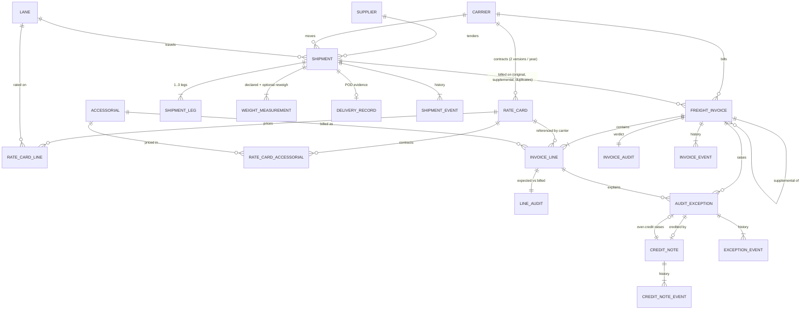

# Design notes: freight invoice audit

This document explains the problem as I understood it, the assumptions I made, how the data model and
rules fit together, how the solution is verified, and where its limits are. The field-level data
dictionary is generated from code: see [DATA_DICTIONARY.md](DATA_DICTIONARY.md).

## 1. Problem understanding

A shipper pays carriers based on invoices the carriers send. Those invoices are often wrong: wrong
weight, wrong tier, an old tariff, surcharges billed twice, accessorials that never happened, or the same
shipment billed twice. The job is to:

1. **Know what the bill *should* be.** Re-rate every shipment from source records: contract (rate
   card), shipment characteristics (lane, service, measured weight and dimensions) and delivery evidence.
2. **Compare billed with expected, line by line.** Every difference is either within rounding tolerance
   or explained by an exception that names its root cause.
3. **Act on it.** Reject, waive, accept or dispute. Disputes follow a lifecycle (analyst, manager
   sign-off, carrier response), and approved disputes are credited.
4. **Close the loop.** Reconcile carrier credit notes against what was approved. Over-credits are
   detected too, not only overbilling.
5. **Measure it.** Show that expected charges are reproducible, exceptions are complete, duplicates are
   caught and credits reconcile, using a ground truth that the audit never reads.

The deliverable is two things: a synthetic data generator (the brief's 10 steps) and a working audit
workflow that runs on that data and is evaluated against it.

## 2. Architecture

```
config.py ─┐ (scale presets, policy thresholds, reference data)
           ▼
generator.py ──► master + transactional tables ──────────────┐   ground truth (separate)
  (rating.py used to build correct bills, then              │   ├─ ground_truth.csv/json
   anomalies injected into specific invoices)               │   ├─ expected_line_charges.csv
                                                            ▼   └─ expected_invoice_outcomes.csv
                                    audit.py  (reads operational tables only)
                                      re-rate → line_audit, invoice_audit, audit_exception
                                                            ▼
                                    settlement.py
                                      dispute workflow (ours) → carrier response + credit notes (simulated)
                                      → audit.reconcile_credits (label-blind) → events, statuses
                                                            ▼
                     export.py (CSV / JSON / SQL seed / SQLite) → validate.py → evaluate.py → manifest
```

* `rating.py` and `policy.py` hold the **documented rules** as pure functions. The generator uses them to
  produce correct baseline bills and expected decisions. The audit uses them to re-rate. Unit tests pin
  them to hand-calculated values.
* The audit engine never imports ground truth. Evaluation is the only place where audit outputs meet labels.
* Every stage draws from its own RNG stream (`random.Random(f"{seed}:{stage}")`), so a change in one stage
  does not shift the random values used by others. Process timings (audit lag, investigation days,
  carrier response days) are simulated. **Decisions are always rule-based.**

## 3. Data model

### 3.1 Entity relationships



* **N:M relationships use bridge tables.** `rate_card_line` resolves RateCard × Lane, extended with
  service level and weight tier. `rate_card_accessorial` resolves RateCard × Accessorial. A missing row
  means "not contracted".
* **Optional relationships:** `delivery_record` (only for delivered shipments), `original_invoice_id` (only
  for supplementals), `audit_exception.invoice_line_id` (empty for invoice-level rules),
  `audit_exception.credit_note_id` (only for credit-reconciliation exceptions).
* **Effective dates:** each carrier has two contiguous, non-overlapping rate cards for 2026. Renewal is on
  Apr 1, Jul 1 or Sep 1, chosen per carrier. The card is selected by `shipment.ship_date`, with both
  `effective_from` and `effective_to` inclusive.
* **Tables I added beyond the brief:** `supplier` (the supplier actor), `delivery_record` (the "delivery
  records" the brief asks invoices to be validated against), the two bridges, the two audit-output tables
  and four append-only event tables.

### 3.2 Lifecycles (history is append-only)

Current `status` columns are *derived* from the last event; validation checks this for every row.

| Entity | State machine |
|---|---|
| Shipment | BOOKED → PICKED_UP → IN_TRANSIT → DELIVERED |
| Invoice | RECEIVED → IN_AUDIT → APPROVED / REJECTED / ON_HOLD; ON_HOLD → SETTLED (all disputes closed) |
| Exception | OPEN → CLOSED_INVOICE_REJECTED / CLOSED_UNDERBILLED_ACCEPTED / CLOSED_WAIVED / DISPUTED / PENDING_MANAGER_REVIEW → DISPUTED → APPROVED / REJECTED_LATE; APPROVED → CREDITED; OPEN → ESCALATED (credit exceptions) |
| Credit note | RECEIVED → APPLIED / APPLIED_PARTIAL / FLAGGED_OVER_CREDIT |

A carrier reweigh is a **new** `weight_measurement` row, never an update. Credits and over-credits are new
records that point back to the dispute.

The data is a snapshot at **2026-11-10 23:59:59**. Anything that would happen later is not recorded. That
is why some shipments are still BOOKED or IN_TRANSIT, some disputes are still OPEN or DISPUTED, and some
approved disputes are still waiting for a credit.

### 3.3 Actors

| Actor (brief) | Where they appear |
|---|---|
| Supplier | `supplier` master; records the SHIPPER_DECLARED weight measurement |
| Planner | books shipments (`shipment_event` BOOKED) |
| Carrier / warehouse operator | pickup, transit, reweigh, invoice submission, dispute response, credit notes; the consignee warehouse confirms DELIVERED |
| Logistics analyst | owns exceptions under $250, files disputes, reconciles credits |
| Operations manager | signs off disputes of $250 or more; receives escalated over-credits; carrier scorecard |

## 4. Business rules

### 4.1 Rating (the expected charge)

| Rule | Definition |
|---|---|
| W1 Authoritative measurement | Latest `CARRIER_REWEIGH`, otherwise latest `SHIPPER_DECLARED` |
| W2 Dimensional weight | `ceil(pieces × L × W × H / dim_divisor)`, with the divisor from the rate card valid on the ship date |
| W3 Billable weight | `max(actual, dim)`, capped at 20,000 lb |
| T1 Weight tier | T1 [0,500), T2 [500,1000), T3 [1000,2000), T4 [2000,5000), T5 [5000,10000), T6 [10000,20000]. Lower bound inclusive. |
| R0 Rate card | the card whose `[effective_from, effective_to]` contains `ship_date` |
| R1 Base freight | `max(min_charge, round_half_up(billable/100 × rate_per_cwt, 2))` for (card, lane, service, tier) |
| R2 Fuel surcharge | `round_half_up(base × fuel_surcharge_pct, 2)`. Accessorials are not fuel-bearing. |
| A1 Accessorial contract | must exist in `rate_card_accessorial` for the valid card |
| A2 Accessorial evidence | must be supported by the delivery record or shipment (e.g. liftgate_used, hazmat, detention = wait > 120 min, billed per started hour) |

### 4.2 Audit rules and root-cause precedence

Invoice-level rules (whole invoice rejected, variance = billed total):
`UNKNOWN_SHIPMENT` → `CARRIER_MISMATCH` → `DUPLICATE_INVOICE` (same carrier + shipment already accepted
as ORIGINAL, or same carrier invoice number ignoring a trailing "R") → `INVALID_SUPPLEMENTAL_REFERENCE` →
`NO_VALID_RATE_CARD`.

Line-level rules apply only when `|billed − expected| > $0.05`. Each line gets at most one root cause:

| Line | Precedence |
|---|---|
| Base | rate card referenced ≠ valid card → `RATE_CARD_EXPIRED` (or `RATE_MISMATCH` if not expired); billed weight ≠ billable (±0.5 lb) → `DIM_WEIGHT_MISMATCH`; tier ≠ tier of billable weight → `WEIGHT_TIER_MISAPPLIED`; else `RATE_MISMATCH`. A second base line → `DUPLICATE_CHARGE` |
| Fuel | second fuel line → `SURCHARGE_DUPLICATED`; card expired → `RATE_CARD_EXPIRED`; pct ≠ contract → `FUEL_SURCHARGE_MISMATCH`; base in exception → **same root cause as base** (cascade); else `FUEL_SURCHARGE_MISMATCH` |
| Accessorial | already billed (this or an earlier accepted invoice) → `SURCHARGE_DUPLICATED`; not contracted → `INVALID_ACCESSORIAL`; no evidence → `INVALID_ACCESSORIAL`; amount differs → `RATE_CARD_EXPIRED` / `ACCESSORIAL_AMOUNT_MISMATCH` |

The cascade rule matters. When a base is overbilled because of an inflated weight, the fuel line is
overbilled too, but its root cause is the weight, not fuel. Without the cascade, one injected error
would show up as two unrelated exception types.

Invoices are audited in **receipt order**. A duplicate is therefore always the *later* submission,
and the earlier one is paid. A supplemental invoice (e.g. detention billed later) is legitimate as long as
it does not repeat a charge that was already billed.

### 4.3 Decisions and dispute workflow (`policy.py`)

| Situation | Outcome |
|---|---|
| Invoice-level rule fired | invoice REJECTED, exception CLOSED_INVOICE_REJECTED |
| Variance < 0 (underbilled) | CLOSED_UNDERBILLED_ACCEPTED (pay what was billed) |
| 0 < variance < $5 | CLOSED_WAIVED (not worth disputing) |
| variance ≥ $5 | dispute; invoice ON_HOLD |
| dispute ≥ $250 | PENDING_MANAGER_REVIEW, then the operations manager files it |
| filed after `invoice_date + carrier.dispute_window_days` | carrier REJECTED_LATE (money lost; reported as a KPI) |
| filed in time | carrier APPROVED for the audited variance, then a credit note |
| credit ≠ approved (beyond $0.05) | credit FLAGGED_OVER_CREDIT (or APPLIED_PARTIAL) plus a new CREDIT_EXCEEDS_EXCEPTION exception, ESCALATED to the operations manager |

## 5. Synthetic data generation (mapping to the brief's 10 steps)

| Step | Implementation |
|---|---|
| 1 Data dictionary | `schema.py` → `docs/DATA_DICTIONARY.md`: type, required, allowed values, unit, uniqueness, rule, FK and cardinality for every field |
| 2 Parents first | carriers, lanes, suppliers, accessorials → rate cards, bridges → shipments, legs, measurements, delivery records, events → invoices, lines → audit → settlement |
| 3 Deterministic IDs | `ids.py`: `CAR-000001`, `RATE-CAR-000001-2026-01`, `SHP-2026-000001`, `FINV-2026-000001`, `FLINE-FINV-2026-000001-01`, `FEX-2026-000001`, plus the same style for children. Regexes live next to the formatters and are validated. |
| 4 Volume | `--scale full` = 100 carriers, 20,000 shipments, 15,000 invoices. `--scale starter` = 10 / 1,000 / 750 from the same code. Seed 20261022. |
| 5 Valid first, then inject | baseline bills are built by rating; then exactly one labelled anomaly is injected per affected invoice (§5.1) |
| 6 Derived values | totals, billable weight, tiers, due dates, delivery performance, statuses, variances and severities are computed, never sampled |
| 7 Separate ground truth | `ground_truth/` (3 files); `GT-ISOLATION` check and unit test assert no label columns in tables |
| 8 Validation | 175 checks (§6) |
| 9 Export | CSV, JSON, `schema.sql` + `seed.sql`, a ready SQLite DB, data dictionary, manifest (generator command, seed, row counts, SHA-256, provenance), validation summary |
| 10 Reproducibility | `python -m freight_audit repro` runs twice and compares all 55 file checksums, and also compares against the committed manifest |

### 5.1 Scenario coverage (full scale)

| Class | Scenario | Count | What is injected | Expected decision |
|---|---|---|---|---|
| Anomaly | UNKNOWN_SHIPMENT | 75 | shipment ref beyond the master's range (looks plausible) | REJECT |
| Anomaly | DUPLICATE_INVOICE | 300 | clean bill resubmitted 7–35 days later, same or "R"-suffixed number | REJECT |
| Anomaly | RATE_CARD_EXPIRED | 217 | whole bill rated with the previous card | DISPUTE or APPROVE (if the old card was cheaper) |
| Anomaly | WEIGHT_TIER_MISAPPLIED | 290 | correct weight, next-lower tier's rate | DISPUTE |
| Anomaly | DIM_WEIGHT_MISMATCH | 290 | billed weight 12–50% above billable (inflated dims) | DISPUTE |
| Anomaly | SURCHARGE_DUPLICATED | 290 | fuel (70%) or an accessorial line repeated | DISPUTE |
| Anomaly | INVALID_ACCESSORIAL | 362 | accessorial not contracted (tariff price) or not evidenced | DISPUTE |
| Anomaly | FUEL_SURCHARGE_MISMATCH | 145 | fuel pct +2–6 points | DISPUTE |
| Anomaly | CREDIT_EXCEEDS_EXCEPTION | 75 | carrier credits 10–60% more than approved | FLAG |
| Boundary | TIER_BREAK_EXACT_WEIGHT | 73 | billable exactly 500/1000/2000/5000/10000 lb | APPROVE |
| Boundary | RATE_CARD_EFFECTIVE_BOUNDARY | 63 | ship date = last day of card 1 / first day of card 2 | APPROVE |
| Boundary | ROUNDING_WITHIN_TOLERANCE | 145 | carrier truncates fuel (−$0.01) | APPROVE |
| Boundary | SUPPLEMENTAL_INVOICE_LEGITIMATE | 150 | detention billed later on a supplemental invoice | APPROVE |
| Normal variant | carrier reweigh heavier than declared | ~25% of shipments | legitimately higher billed weight | APPROVE |
| Normal variant | dim weight governs | ~32% of shipments | bulky freight billed on dim weight | APPROVE |

**Materiality.** An injected anomaly is kept only if it moves the root line by at least $5. Otherwise
(e.g. a tier error hidden by the minimum charge) the generator picks another invoice. This keeps the
labels meaningful: an "anomaly" always has a monetary effect the audit can see.

**Distributions** (see `reports/evaluation_report.md` → Data profile): skewed carrier volume (70–1,874
shipments per carrier), 70/22/8 service mix, monthly seasonality, 1/2/3-leg routings via hubs, lognormal
pallet weights plus a bulky segment, reweigh deltas averaging +6.5%, about 83% on-time delivery, about 12%
detention, accessorial incidence between 4% and 22%.

## 6. How I know it works

1. **Unit tests with hand calculations** (`tests/test_rating.py`): tier edges, dim-weight ceiling, minimum
   charge, half-up rounding (`25.025 → 25.03`), detention hours, reweigh precedence, policy thresholds.
2. **Validation suite** (`validate.py`, 175 checks, all PASS at both scales): PK uniqueness, FK integrity
   (32 relationships; only the 75 labelled unknown-shipment refs may dangle, and the check fails if the set
   differs by even one), enums, ID formats, types, required fields, uniqueness, date ordering, arithmetic
   reconciliation (line math, totals, dim/billable, audit variance = exceptions + tolerance, credit =
   reconciled + excess), lifecycle state machines, duplicate checks, ground-truth isolation, and an
   independent SQLite `PRAGMA foreign_key_check` plus lossless-join check.
3. **Evaluation against ground truth**: expected-charge reproduction, per-type precision/recall/F1,
   false-positive rate on clean and boundary invoices, decision accuracy, explanation completeness and
   credit reconciliation.
4. **Negative controls** (`tests/test_pipeline.py`): I break the audit on purpose (ignore reweighs, or trust
   every accessorial) and assert that the metrics drop. I also corrupt the data (amount, FK, illegal
   transition) and assert that the right validation checks fail. This shows that the perfect scores
   below are not an artefact of a check that cannot fail.
5. **Reproducibility**: two runs with the same seed give identical SHA-256 for all 55 output files,
   including the SQLite DB. A different seed gives different data.

### Results (full scale, seed 20261022)

| Measure | Result |
|---|---|
| Expected charge reproduced exactly | 41,167 / 41,167 lines |
| Detection precision / recall (8 invoice anomaly types) | 1.0 / 1.0 (1,969 TP, 0 FP, 0 FN) |
| Exceptions on clean or boundary invoices | 0 / 13,031 |
| Decision accuracy | 15,000 / 15,000 |
| Over-credits flagged | 75 / 75, 0 false flags |
| Credits without an approved dispute | 0 |
| Overbilling identified / rejected invoices prevented | $319,773 / $671,493 on $25.87M billed |
| Lost to late disputes | $3,713 (20 disputes) |

**How to read the perfect scores.** They show that the audit implements the documented rules and that
the data is internally consistent. They are **not** a claim about real-world accuracy. The generator and
the audit share the same rule definitions, and each anomaly is clean, single-cause and material. Real
invoices would include ambiguous and compound errors, and the metrics would be lower. §8 lists what I would
add to make the benchmark harder.

## 7. Key decisions and trade-offs

| Decision | Why | Trade-off |
|---|---|---|
| Python standard library only | one-command setup, nothing to install, deterministic | no pandas/pydantic conveniences; more hand-written code |
| `Decimal` with explicit half-up rounding for money | exact cents; rounding rule is part of the contract | slower than floats (still about 26 s for the full run including all exports) |
| Schema metadata drives docs, DDL, CSV order and generic checks | one source of truth; the dictionary cannot drift from the data | a custom mini-framework instead of a library |
| One injected anomaly per invoice | clean, unambiguous labels; per-type metrics are meaningful | does not test compound errors (see §8) |
| Invoice `shipment_id` keeps the FK even when dangling | the brief asks for FKs *and* an unknown-shipment case | the SQL seed loads with `PRAGMA foreign_keys=OFF`; documented in `schema.sql` |
| Audit and settlement emitted as data tables | exceptions and credits become traceable records with history | the dataset mixes inputs and derived outputs; `layer` in the dictionary separates them |
| Processing order = receipt order | defines which copy of a duplicate is "the duplicate" | a duplicate received before its original would invert roles (not generated) |
| Shared rating code for generator and audit | the "expected charge" has exactly one definition | evaluation cannot catch a wrong *rule*, only a wrong *implementation or lookup*; mitigated by hand-calculated unit tests |
| Underbilling accepted, < $5 waived | mirrors common AP practice; keeps disputes meaningful | thresholds are assumptions, configurable in `config.py` |
| Snapshot as-of date | realistic open items (pending disputes, in-transit shipments) | some numbers (e.g. late rejections) depend on the snapshot date |

## 8. Assumptions, limitations and next steps

**Assumptions**
- Currency is USD only, there is a single contract year, and the network is US-only. Times are local with no time zone.
- LTL-style rating per hundredweight with six weight tiers. No freight class/NMFC, no deficit-weight
  ("rate as next tier") optimisation, no distance-based fuel tables. The fuel percentage is fixed per card.
- Only the base line is fuel-bearing. Detention is billed per started hour after 120 free minutes.
- The delivery record is the source of truth for accessorial evidence. The carrier always approves timely
  disputes for the audited amount.
- Every invoice received before the as-of date has been audited (audit lag 0–4 days).

**Limitations**
- Each anomaly invoice has exactly one root cause, and all anomalies are material. Real data has compound,
  borderline and noisy cases, so the 1.0 metrics are an upper bound that verifies rule implementation, not
  real-world accuracy.
- Carrier behaviour (response time, approval) is simple. Credits are 1:1 with disputes; real carriers
  batch credits across invoices.
- Late-dispute rejection is the only reason a carrier rejects a dispute.
- The full-scale CSV/JSON/SQL exports (about 290 MB) are not committed. They regenerate in about 30 s, and
  `repro --scale full` checks them against the committed manifest checksums.

**Next steps**
1. A "hard" scenario pack: compound anomalies, noisy reweighs near tolerance, duplicates with altered
   amounts, partial credits and batched credit notes, to produce a realistic precision/recall curve.
2. An independent "oracle" re-implementation of the rating rules (or SQL views) to cross-check
   `rating.py`, instead of relying only on hand-calculated unit tests.
3. Freight class and deficit-weight rating, fuel index tables by week, and accessorial minimums.
4. A small UI or notebook for analysts: exception queue, evidence pack per dispute, carrier scorecard trends.
